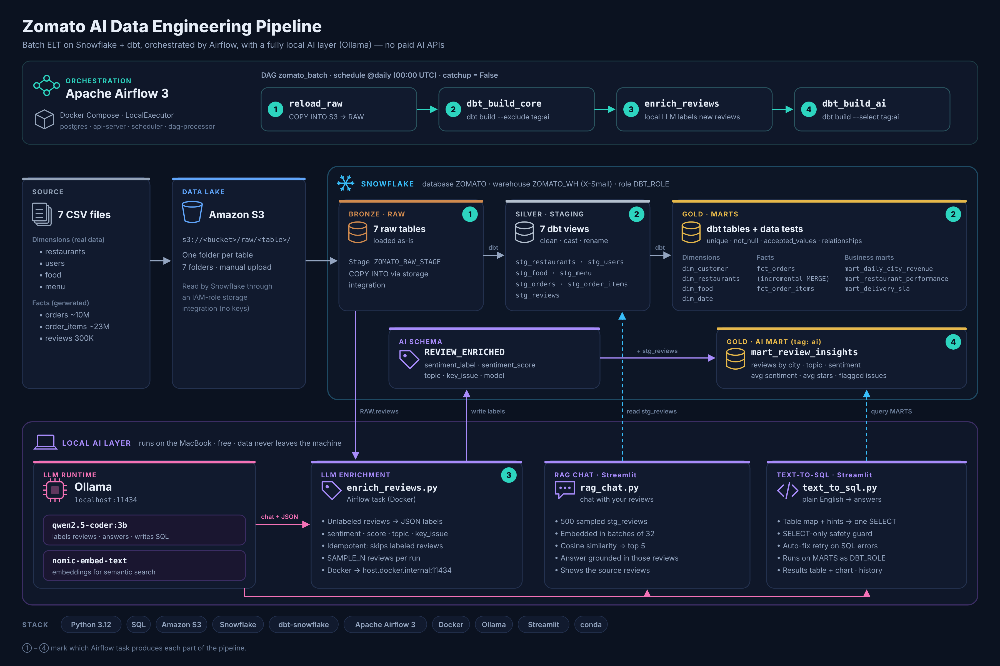
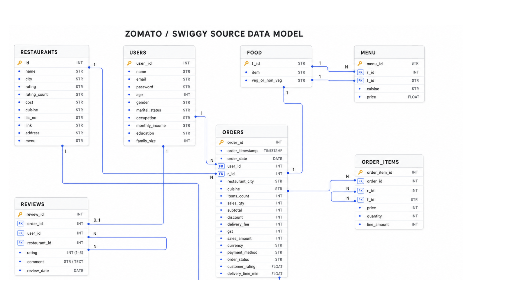
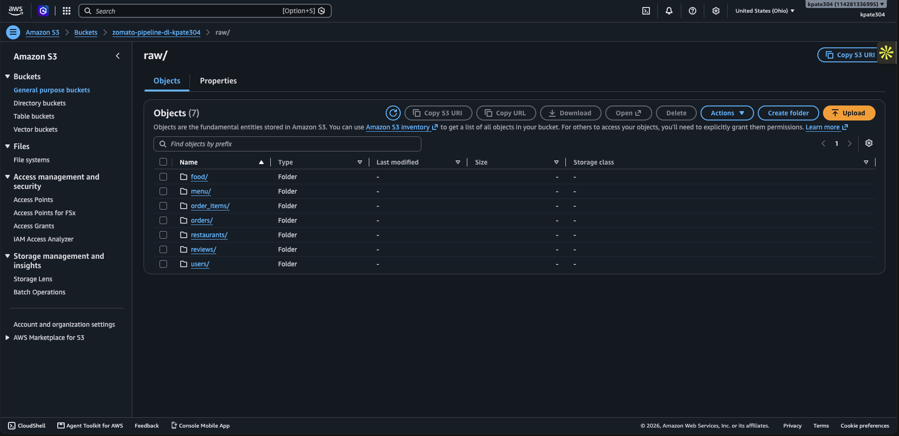
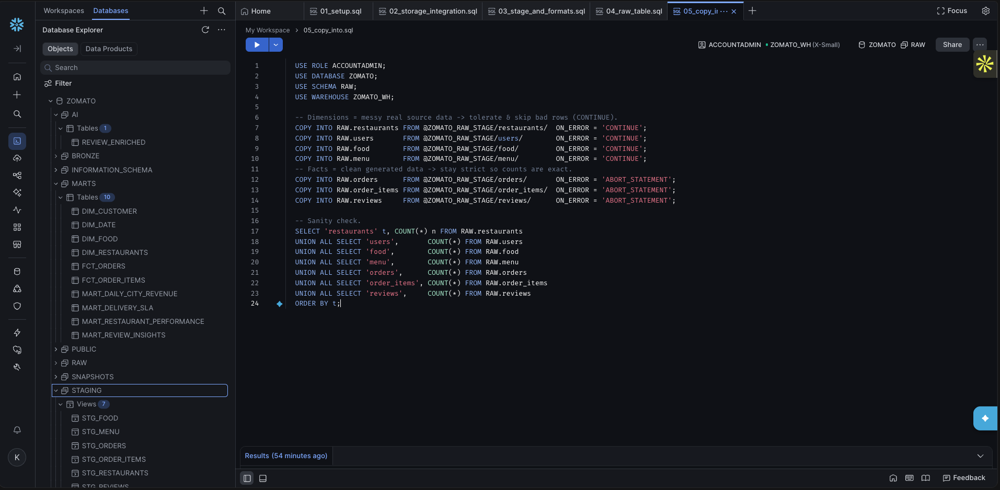
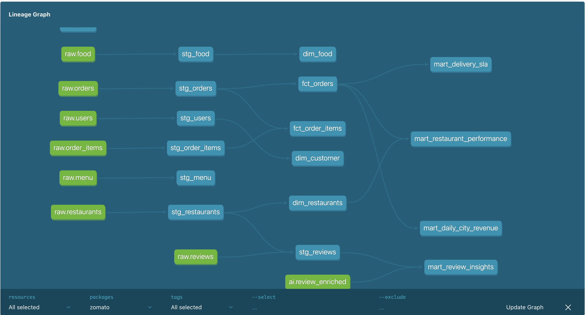
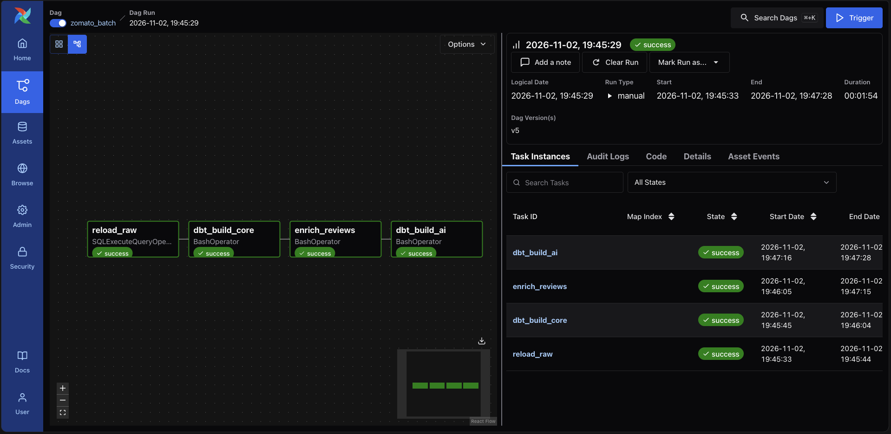
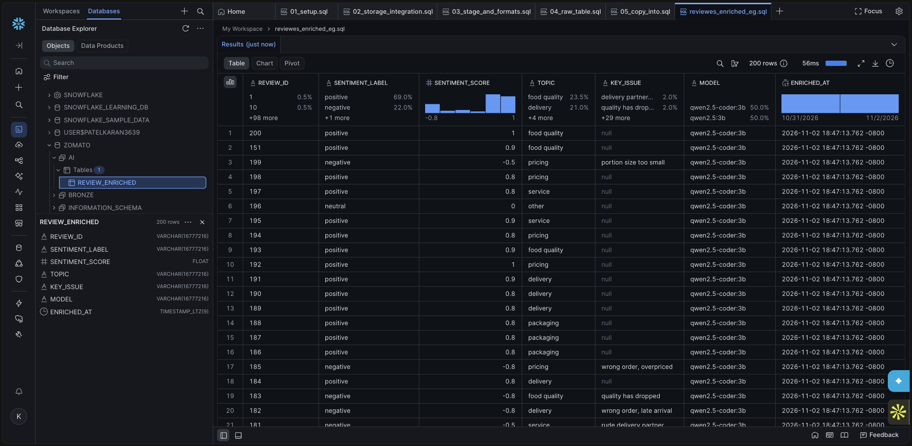
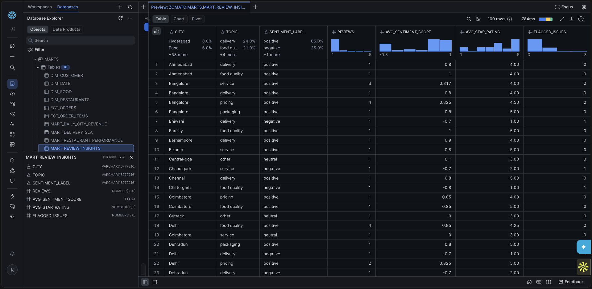
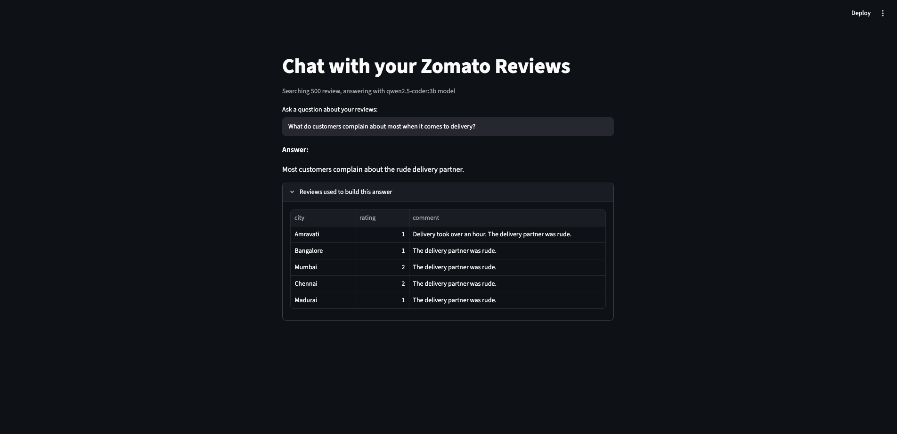
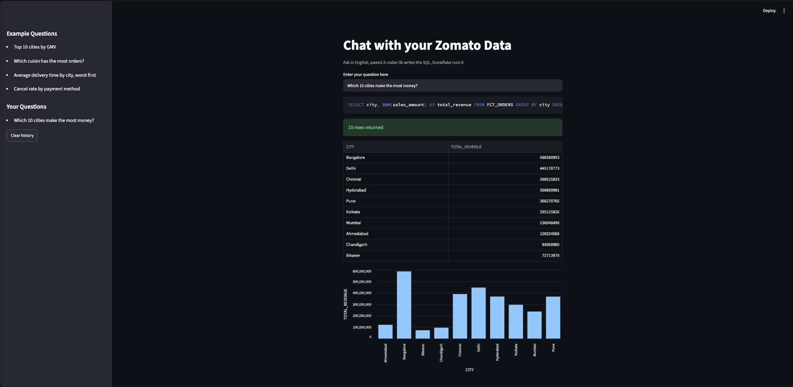

# Zomato AI Data Engineering Pipeline

An end-to-end batch data pipeline that takes food-delivery data from raw CSV files to an AI-powered analytics layer. The AI part runs **fully locally with Ollama**, so there are no paid AI APIs.

**Amazon S3 → Snowflake → dbt → Apache Airflow → Ollama (local LLM) → Streamlit**



---

## What it does

- **Loads** ~10M orders, ~23M order items and 300K customer reviews from an S3 data lake into Snowflake
- **Transforms** the data through medallion layers with dbt: RAW (Bronze) → STAGING (Silver) → MARTS (Gold)
- **Orchestrates** the whole flow as one daily Airflow DAG running in Docker
- **Enriches** free-text reviews with a local LLM (sentiment, topic, key issue) and models the results in dbt
- **Serves** two AI apps in Streamlit:
  - **Chat with reviews (RAG):** answers grounded in real customer reviews
  - **Text-to-SQL:** a non-technical user asks a question in plain English, the model writes the SQL, and Snowflake runs it

---

## Tech stack

| Layer | Tool |
|---|---|
| Data lake | Amazon S3 |
| Warehouse | Snowflake |
| Transformation | dbt (dbt-snowflake) |
| Orchestration | Apache Airflow 3 (Docker) |
| LLM (local) | Ollama: `qwen2.5-coder:3b` (text and SQL), `nomic-embed-text` (embeddings) |
| Apps | Streamlit |
| Language | Python 3.12, SQL |

---

## Data model

Seven source tables: four dimensions (restaurants, users, food, menu) and three facts (orders, order items, reviews).



---

## Pipeline

### 1. Lake: Amazon S3
One bucket with a `raw/<table>/` folder per CSV file.



### 2. Bronze: Snowflake RAW
Snowflake reads from S3 through a storage integration (IAM role, no access keys) and an external stage, and loads the files with `COPY INTO`.



### 3. Silver and Gold: dbt
- **Staging (views):** clean, type and rename every source (for example `"--"` → NULL, `"₹ 200"` → 200)
- **Marts (tables):**
  - Dimensions: `dim_customer`, `dim_restaurants`, `dim_food`, `dim_date`
  - Facts: `fct_orders` (**incremental, MERGE**), `fct_order_items`
  - Business marts: `mart_daily_city_revenue`, `mart_restaurant_performance`, `mart_delivery_sla`
  - AI mart: `mart_review_insights` (tagged `ai`)
- Data tests: `unique`, `not_null`, `accepted_values`, `relationships`



### 4. Orchestration: Apache Airflow
One daily DAG, `zomato_batch`:

```
reload_raw  →  dbt_build_core  →  enrich_reviews  →  dbt_build_ai
(COPY INTO)    (dbt build,        (local LLM labels   (AI mart)
               excludes AI)       new reviews)
```



### 5. AI layer: Ollama (local, free)

#### LLM enrichment (`ai/enrich_reviews.py`)
Reads reviews that haven't been labeled yet, asks the local model for structured JSON (sentiment, score, topic, key issue), and writes the results to `ZOMATO.AI.REVIEW_ENRICHED`. It's idempotent: already-labeled reviews are skipped.



dbt then turns the labels into `mart_review_insights`: reviews by city, topic and sentiment, with average sentiment, average star rating and flagged issues.



#### RAG chat (`ai/rag_chat.py`)
Embeds a sample of reviews with `nomic-embed-text`, finds the ones most similar to the question, and answers using only those reviews. The source reviews are shown under every answer.



#### Text-to-SQL (`ai/text_to_sql.py`)
A non-technical user asks a business question in plain English, for example *"Which 10 cities make the most money?"* The local model writes the SQL, a safety check allows only read-only queries, Snowflake runs it, and the app shows the answer as a table and a chart.



---

## Improvements made while building

- **Local LLM instead of a paid API:** all AI calls go to Ollama, configured through environment variables (`LLM_BASE_URL`, `LLM_MODEL`, `EMBEDDING_MODEL`)
- **Code-specialized model:** `qwen2.5-coder:3b` writes much more accurate SQL than a general model of the same size
- **Batched embeddings:** reviews are embedded 32 at a time, so the local model doesn't crash on large requests
- **Corrected table map for text-to-SQL:** table and column names match the real dbt models, plus hints and examples for common patterns (aggregating daily data by city, calculating cancel rate from orders)
- **Self-correcting SQL:** if Snowflake rejects a query, the error is sent back to the model for one automatic fix
- **Question history** in the text-to-SQL sidebar
- **Docker networking:** Airflow reaches Ollama on the host machine through `host.docker.internal`

---

## Project structure

```
├── ai/
│   ├── enrich_reviews.py        # LLM enrichment of reviews → Snowflake
│   ├── rag_chat.py              # Streamlit: chat with reviews (RAG)
│   └── text_to_sql.py           # Streamlit: English → SQL → Snowflake
├── airflow/
│   ├── Dockerfile               # Airflow 3 + Snowflake provider + dbt
│   ├── docker-compose.yaml      # postgres, api-server, scheduler, dag-processor
│   └── dags/zomato_batch.py     # the 4-step pipeline
├── snowflake/                   # setup SQL: warehouse, database, role, S3 integration, tables, COPY
├── zomato/                      # dbt project
│   ├── models/staging/          # 7 staging views + sources + tests
│   ├── models/marts/            # dimensions, facts, marts
│   └── macros/
└── docs/screenshot/
```

---
## Author

**Karan Ramesh Patel**

- GitHub: [@PatelKaran22](https://github.com/PatelKaran22)
- LinkedIn: [Karan Patel](https://www.linkedin.com/in/karanpatel18/)

<!-- ## How to run it

### Prerequisites
- macOS (Apple Silicon), 16 GB RAM recommended
- [Miniconda](https://docs.anaconda.com/miniconda/), [Docker Desktop](https://www.docker.com/products/docker-desktop/), [Ollama](https://ollama.com)
- A Snowflake account and an AWS account

### 1. Snowflake and S3
1. Upload the CSV files to S3, one folder per table: `raw/orders/`, `raw/users/`, …
2. Run the scripts in `snowflake/` in order, in a Snowsight worksheet.

### 2. Python environment
```bash
conda create -n zomato python=3.12 -y
conda activate zomato
pip install dbt-core dbt-snowflake openai python-dotenv streamlit pandas numpy pyarrow "snowflake-connector-python[pandas]"
```

### 3. Local models
```bash
ollama pull qwen2.5-coder:3b
ollama pull nomic-embed-text
```

### 4. Settings (not committed; create them yourself)

`ai/.env`
```
SNOWFLAKE_ACCOUNT=
SNOWFLAKE_USER=
SNOWFLAKE_PASSWORD=
SNOWFLAKE_WAREHOUSE=ZOMATO_WH
SNOWFLAKE_DATABASE=ZOMATO
SNOWFLAKE_SCHEMA=AI
OPENAI_API_KEY=ollama
LLM_BASE_URL=http://localhost:11434/v1
LLM_MODEL=qwen2.5-coder:3b
EMBEDDING_MODEL=nomic-embed-text
```

`airflow/.env`
```
SNOWFLAKE_ACCOUNT=
SNOWFLAKE_USER=
SNOWFLAKE_PASSWORD=
OPENAI_API_KEY=ollama
SAMPLE_N=5
LLM_BASE_URL=http://host.docker.internal:11434/v1
LLM_MODEL=qwen2.5-coder:3b
```

`OPENAI_API_KEY=ollama` is only a placeholder that the Python client library requires. Ollama ignores it, and no external API is called.

`zomato/profiles.yml`
```yaml
zomato:
  target: dev
  outputs:
    dev:
      type: snowflake
      account: "{{ env_var('SNOWFLAKE_ACCOUNT') }}"
      user: "{{ env_var('SNOWFLAKE_USER') }}"
      password: "{{ env_var('SNOWFLAKE_PASSWORD') }}"
      role: DBT_ROLE
      warehouse: ZOMATO_WH
      database: ZOMATO
      schema: STAGING
      threads: 8
```

### 5. Run the pipeline
```bash
cd airflow
docker compose build
docker compose up -d
```
Open http://localhost:8080 (`admin` / `admin`), switch on `zomato_batch`, and click **Trigger**.

### 6. Run the AI apps
```bash
cd ai
streamlit run rag_chat.py
streamlit run text_to_sql.py
``` -->